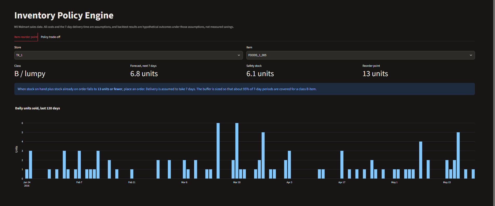
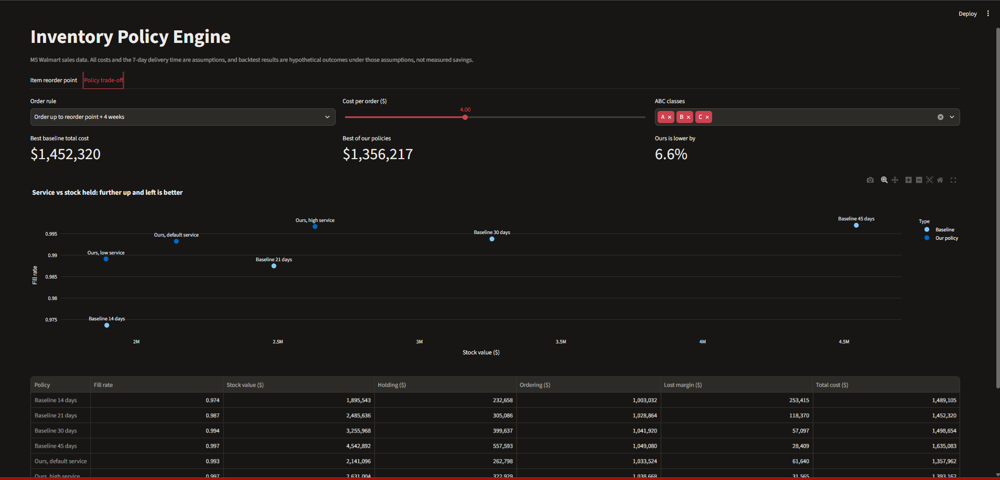
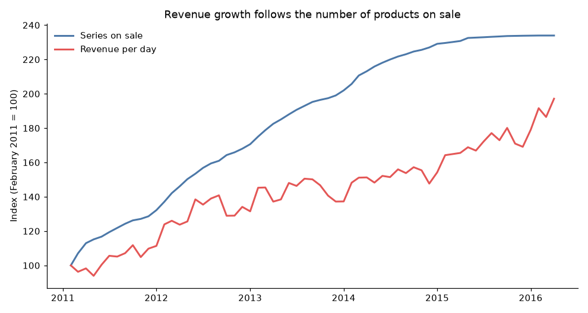
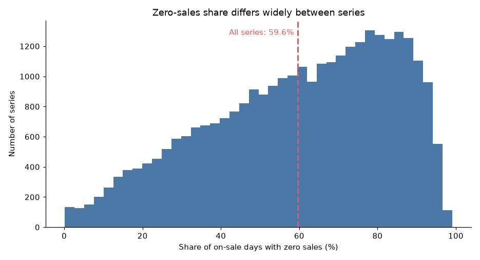
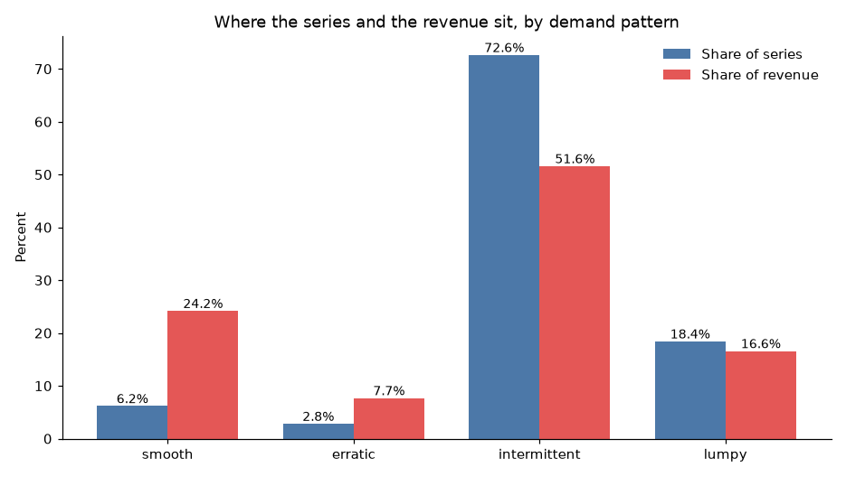
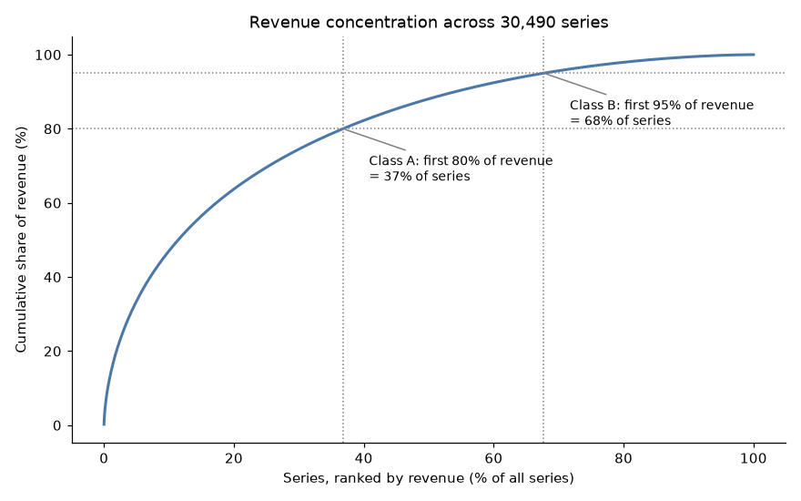
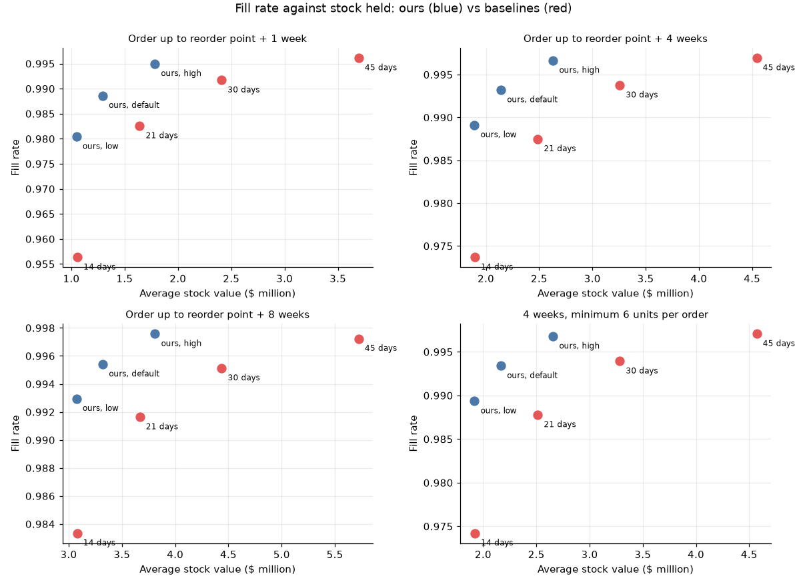

# Inventory Policy Engine

> Sizing reorder points and safety stock from real forecast errors across 30,490 item-store series, and testing the policy against the common "N days of sales" rule.

   

---

## Overview

A store manager has to decide, for every product, when to reorder and how much buffer stock to keep. Many shops apply one rule to every product, such as "reorder at 30 days of average sales". This project uses five years of real Walmart sales data to size the buffer from each product class's observed forecast misses, then replays the last 224 days under both approaches to compare service, stock held and cost.

**Series: 30,490 | Sales rows: 59.2M | Stores: 10 | Items: 3,049 | Backtest: 224 days**

> All costs and the 7-day delivery time are assumptions, because the data has no stock levels, costs or lead times. Backtest results are hypothetical outcomes under those assumptions, not measured savings.

---

## App Preview





---

## Key Insights

| Finding | Detail |
|---|---|
| Zero-sales share | **68.00%** of all item-store-days; **59.60%** on days the item was on sale |
| Late-starting series | **64.1%** (19,558 of 30,490) have no price in week 1; none sold before its first price |
| Demand pattern | **91%** of series are intermittent or lumpy; only 6.2% are smooth |
| Where the revenue sits | About **68%** of revenue is in intermittent or lumpy series (SQL analysis) |
| Forecast method | 28-day average (error 0.340) matched TSB (0.342) and beat the 90-day average (0.371) and SBA (0.380) |
| Same stock, better service | At about $1.05M of stock, fill rate **98.0%** (ours) vs **95.6%** (14-day rule) |
| Against the 30-day rule | **46% less stock**, 0.3 points lower fill rate, 9.6% lower total cost at $2 per order |
| Robustness | Ours cost **3.0% to 29.0% less** than the best baseline in all 12 combinations of 4 order rules and 3 order costs |
| At $2 per order | All three of our service-level variants cost less than every baseline under all four order rules |
| Weakest result | The cost advantage shrinks to 3.0% to 4.5% when each order costs $10 |

---

## Figures

**Revenue growth follows the number of products on sale**


**Zero-sales share differs widely between series**


**Where the series and the revenue sit, by demand pattern**


**Revenue concentration across series**


**Fill rate against stock held: ours vs baselines, by order rule**


---

## App Features

- Item view: pick a store and item to see its class, 7-day forecast, safety stock and reorder point
- Daily sales chart for the last 120 days
- Policy view: choose the order rule (4 options), cost per order ($0 to $10) and ABC classes
- Fill rate against stock held for every policy, and a cost breakdown table
- "Ours is lower by" metric that updates with the selections

---

## Tech Stack

| Tool | Purpose |
|---|---|
| Python (pandas, NumPy) | Pipeline, forecasting, policy and backtest simulation |
| Parquet (PyArrow) | Compact storage of 59M-row tables |
| DuckDB, SQL | Data checks and business queries run directly on the Parquet files |
| Streamlit, Plotly | Interactive app |
| uv | Reproducible environment |
| Git, GitHub | Version control |

---

## Pipeline

| Step | Script | What it does |
|---|---|---|
| 1 | `ingest.py` | Reshapes 1,941 day columns into one row per item, store and day, one store at a time |
| 2 | `validate.py` | Checks row count (59,181,090), nulls and negative sales |
| 3 | `availability.py` | Finds each product's first price day and tests that nothing sold before it |
| 4 | `zero_share.py` | Zero share on days the item was on sale, and its spread across series |
| 5 | `classify.py` | ABC by revenue and demand pattern (smooth, erratic, intermittent, lumpy) |
| 6 | `forecast.py` | Compares forecast methods on 7-day totals (optional step) |
| 7 | `policy.py` | Safety stock and reorder point for every series |
| 8 | `backtest.py` | Replays the last 224 days under each policy, order rule and order cost |
| 9 | `build_app_data.py` | Builds the small files the app reads |

---

## SQL Layer

DuckDB runs standard SQL directly on the Parquet files, so no database server is needed.

| File | What it does |
|---|---|
| `sql/01_views.sql` | One view per table, including the sales, calendar, prices join chain |
| `sql/02_checks.sql` | Data checks: row count, null keys, one row per item-day, series counts, sales before first price, zero share |
| `sql/03_analysis.sql` | Business questions using joins, CTEs, window functions (RANK, LAG, running totals) and ROLLUP |

The SQL checks reproduce the Python results (59,181,090 rows, 59.60% zero share on available days, ABC class counts).

---

## Key Calculations

```
Forecast (7 days)     = average daily sales of last 28 available days x 7
Normal weekly level   = average daily sales over available history x 7
Miss ratio            = (actual 7-day demand - forecast) / normal weekly level
Safety stock          = percentile of miss ratio at the service target
                        (A 98%, B 95%, C 90%) x normal weekly level
Reorder point         = forecast + safety stock, rounded up to whole units
Fill rate             = units sold / units demanded
Total cost            = holding (20% a year on stock valued at 70% of price)
                        + $2 per order + lost margin (30% of price)
```

---

## Project Structure

```
Inventory_Policy_Engine/
│
├── src/
│   ├── config.py            # paths, constants, assumptions
│   ├── ingest.py            # raw CSV -> long-format Parquet
│   ├── validate.py          # data checks
│   ├── availability.py      # first price day, sold-before-price test
│   ├── zero_share.py        # honest zero share
│   ├── classify.py          # ABC and demand pattern
│   ├── forecast.py          # forecast method comparison
│   ├── policy.py            # safety stock and reorder points
│   ├── backtest.py          # policy replay and cost comparison
│   ├── build_app_data.py    # app data
│   └── run_sql.py           # runs the SQL files
├── sql/
│   ├── 01_views.sql         # views over the Parquet files, incl. the join chain
│   ├── 02_checks.sql        # data checks in SQL
│   └── 03_analysis.sql      # business questions: joins, CTEs, window functions
├── app/
│   └── streamlit_app.py     # interactive app
├── tests/
│   ├── test_policy.py       # forecast and safety stock math
│   └── test_backtest.py     # replay simulation
├── notebooks/
│   └── 01_eda.ipynb         # builds the five figures
├── notes/                   # data understanding, assumptions, decisions log, code walkthrough
├── reports/
│   ├── case_study.md        # full write-up with results and caveats
│   └── figures/             # app screenshots
├── data/                    # raw, interim, processed (not committed)
├── pyproject.toml
└── README.md
```

---

## How to Run

1. Install [uv](https://docs.astral.sh/uv/) and run `uv sync`
2. Download the three data files from Kaggle and place them in `data/raw/` (create the folder first)
3. Run the pipeline from the project root, in order:
   ```
   uv run python src/ingest.py
   uv run python src/validate.py
   uv run python src/availability.py
   uv run python src/zero_share.py
   uv run python src/classify.py
   uv run python src/policy.py
   uv run python src/backtest.py
   uv run python src/build_app_data.py
   ```
4. Start the app: `uv run streamlit run app/streamlit_app.py`
5. Optional, SQL checks and analysis (DuckDB):
   ```
   uv run python src/run_sql.py sql/02_checks.sql
   uv run python src/run_sql.py sql/03_analysis.sql
   ```
6. Optional, tests: `uv run pytest -q`

The full pipeline processes about 59 million rows, one store at a time to keep memory use low.

---

## Dataset

- **Source:** [M5 Forecasting - Accuracy (Walmart), Kaggle](https://www.kaggle.com/c/m5-forecasting-accuracy)
- **Files used:** `calendar.csv`, `sales_train_evaluation.csv`, `sell_prices.csv`
- **Records:** 30,490 item-store series, 1,941 days of daily unit sales, 6.8 million weekly price rows
- **Not included in this repository.** Download from Kaggle after accepting the competition rules.

---

## Assumptions and Limitations

- Holding cost (20% a year), unit cost (70% of price), order cost ($2), lost margin (30% of price) and the 7-day delivery time are assumptions. All are listed in `notes/assumptions.md`.
- Observed sales stand in for demand. Stockouts can hide true demand, and the data cannot show them.
- One 224-day test window, one delivery time, no promotions, and daily review of every item.
- ABC classes use total revenue (not margin) over each series' available days and were computed over the full history, so late launches rank lower than their sales rate justifies.
- Full results and caveats: `reports/case_study.md`