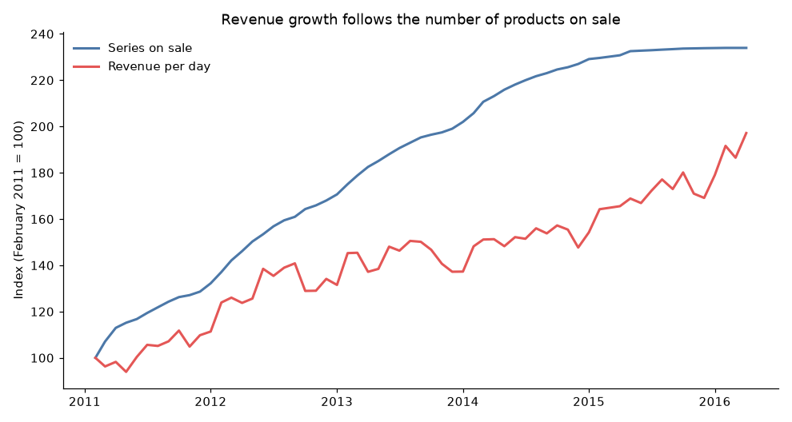
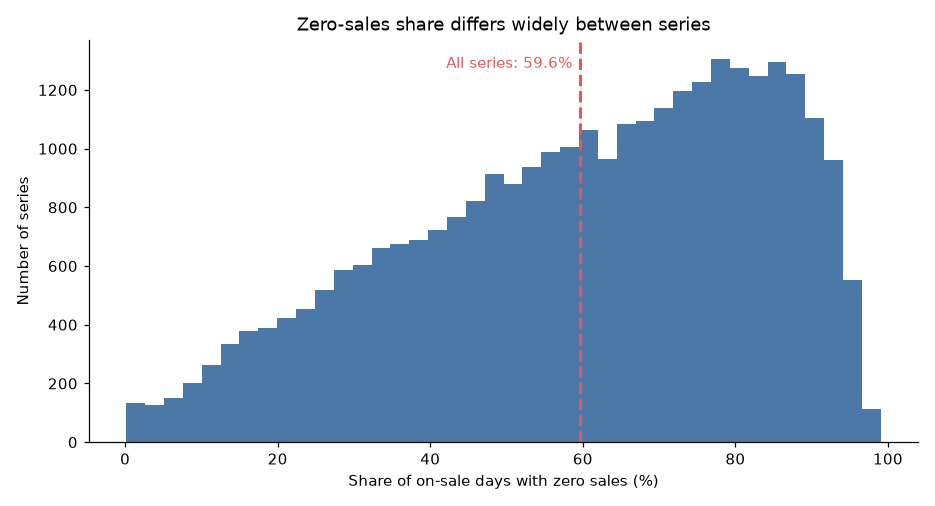
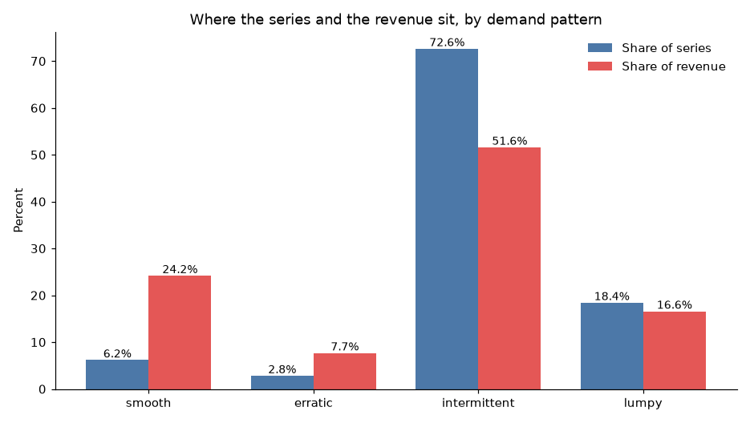
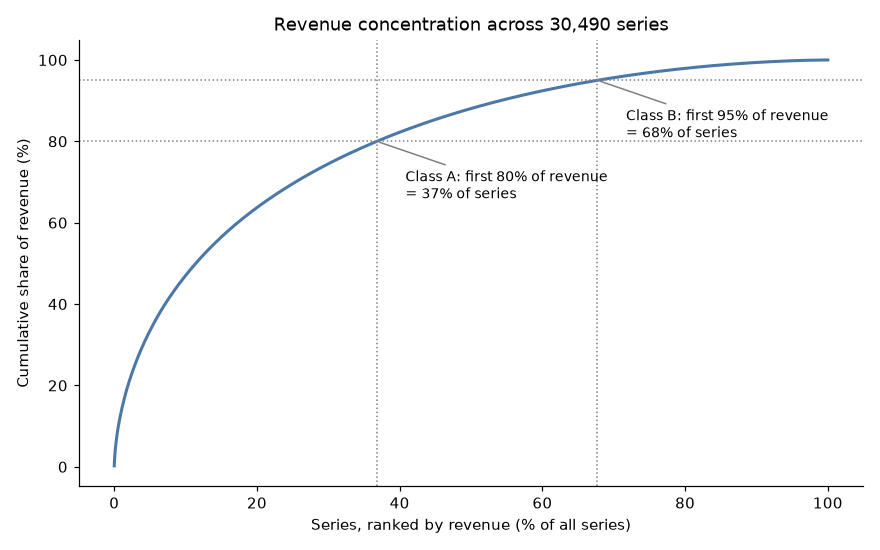
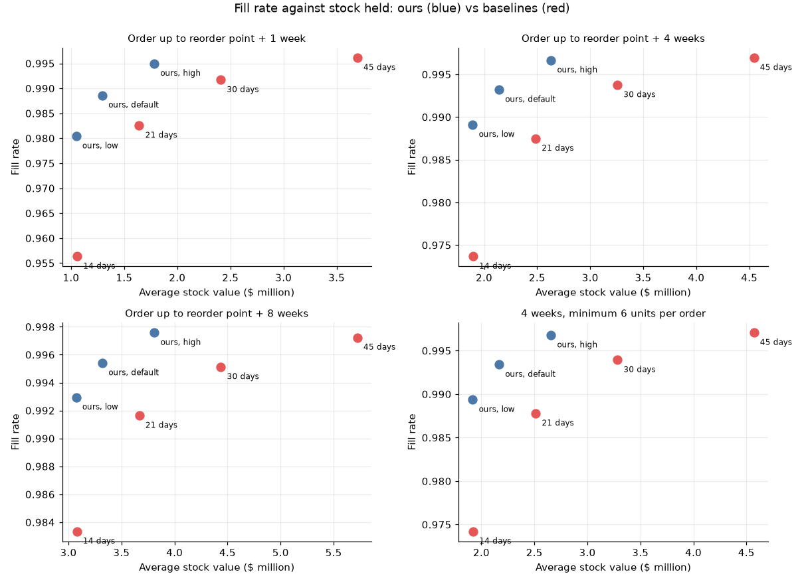

# Case Study: Inventory Policy Engine

## Summary

A retailer that reorders every product at "N days of average sales" holds more stock than it needs for the service it gets. Using five years of Walmart sales data for 30,490 item-store series, I built a policy whose safety stock is sized from each product's observed forecast misses, and replayed the last 224 days under both policies. Under assumed costs, the policy held 14% to 21% less stock than the best baseline at equal or higher fill rate. These are hypothetical backtest results, not measured savings.

## 1. What problem are we solving?

**Who has the problem.** Store and category managers who place replenishment orders.

**The decision.** For every product, when to reorder (the reorder point) and how much buffer to hold (the safety stock).

**Why it matters.** Holding too little loses sales. Holding too much ties up cash and storage. Many shops use one rule for every product, such as "reorder at 30 days of average sales", although products differ greatly in how they sell.

**Success measures.**
- Fill rate: units sold divided by units demanded.
- Stock value: money held on the shelf, at cost.
- Total cost: holding cost + ordering cost + lost margin on missed sales.

**Impact type.** All impact figures in this study are *hypothetical backtest results under stated assumptions*. Nothing here is measured real-world saving.

## 2. Where does the data come from?

**Source.** M5 Forecasting (Walmart), Kaggle: https://www.kaggle.com/c/m5-forecasting-accuracy. Real retail data, public, released for a forecasting competition.

**Files used.**

| File | Content |
|---|---|
| `sales_train_evaluation.csv` | Daily units sold per item and store, 30,490 rows, 1,941 day columns |
| `calendar.csv` | 1,969 days with dates, week codes, events |
| `sell_prices.csv` | Weekly price per item and store, 6,841,121 rows |

10 stores in 3 US states, 3,049 items, about 5.3 years of history. The validation file (same data, 28 days shorter) and the submission sample were not used.

**What the data lacks.** No stock levels, no stockout records, no unit costs, no supplier delivery times, no ordering or holding costs. These were assumed and listed in `notes/assumptions.md`. Observed sales are used as a stand-in for demand, although stockouts can hide real demand.

## 3. What did we do with the data?

**Data engineering.**
- Reshaped the wide sales file (1,941 day columns) into one row per item, store and day: 59,181,090 rows, processed one store at a time to limit memory, and stored as Parquet.
- Validated the result: total row count, no nulls, no negative sales.

**Finding when each product reached the shelf.**
- 64.1% of item-store series (19,558 of 30,490) have no price in the first week of the data. 2,718 of 3,049 items start late in at least one store, and 1,592 start late in every store.
- Test of the assumption "first price week is when the product went on sale": no series sold before its first price (0 of 30,490), and every series sold at least once. No series lost its price after launch.

**Zero sales.**
- 68.00% of item-store-days have zero sales. 12,299,413 of the 59,181,090 cells (20.8%) are days before the item's first price, so they are not demand zeros.
- On days the item was on the shelf, the zero share is 59.60%. It varies widely between series: 26% at the 10th percentile, 63% at the median, 89% at the 90th percentile.

**Classification (available days only).**
- By revenue: A (first 80% of revenue) 11,221 series, B (next 15%) 9,426, C (last 5%) 9,843.
- By demand pattern, using the average gap between sales and the variation in sale size with the standard cut-offs from the intermittent-demand literature: intermittent 72.6%, lumpy 18.4%, smooth 6.2%, erratic 2.8%.

**Forecasting.** Compared on 7-day totals (the delivery wait) with a rolling test at 8 dates per series, on 807 series sampled across the classes. Weighted absolute percentage error: 28-day moving average 0.340, TSB 0.342, 90-day moving average 0.371, SBA (Croston-type) 0.380. No method clearly beat the 28-day average, which became the main forecast. Smoothing parameters were not tuned.

**Safety stock.**
- For each series and test date, the miss is actual 7-day demand minus the forecast, divided by the series' normal weekly demand.
- For each ABC and demand class, the safety stock ratio is the percentile of these misses that matches the service target (A 98%, B 95%, C 90%). Classes with too few observations use the pooled value for their ABC class.
- Reorder point = forecast for the 7-day delivery wait + safety stock, rounded up to whole units.
- The textbook bell-curve formula was avoided because demand is bursty and mostly zero.

**Backtest.** The last 224 days replayed day by day for every series: deliveries arrive after 7 days, unmet demand is lost, and each policy faces the same real sales. Buffer ratios were fitted only on forecast misses from before the test period. Baselines reorder at 14, 21, 30 or 45 days of average sales. Costs assumed: holding 20% a year of stock at 70% of price, $2 per order, lost margin of 30% of price.

**Order-rule sensitivity.** The same test under four ordering rules (order up to the reorder point plus 1, 4 or 8 weeks of demand, and 4 weeks with a minimum of 6 units) and three order costs ($0, $2, $10).

**SQL.** Data checks and nine business questions written in SQL (DuckDB) over the same Parquet files, using joins, CTEs, window functions (RANK, LAG, running totals) and ROLLUP. The SQL checks reproduce the Python results: 59,181,090 rows, 59.60% zero share on available days, and the ABC class counts.

**Application.** A Streamlit app shows the reorder point for any item and the service-versus-stock trade-off for any order rule and order cost.

## 4. What did we discover, and what is the business impact?

### Measured from the data

- Demand is intermittent: even on days the item is on sale, 59.6% have no sale, and 91% of series are intermittent or lumpy.
- The 68% headline zero share overstates real zero demand by 8.4 points, because it counts days before products existed in the store.
- Only about 6% of series have smooth demand, so methods that assume steady demand fit a small part of the range.
- Most of the revenue sits in hard-to-forecast series: about 68% of revenue is in intermittent or lumpy series (class A intermittent series alone hold 35.8%). Smooth class A series hold 24.0% of revenue from 5.7% of series.
- Zero share on available days differs by department: highest in HOBBIES_2 (84.8%) and HOUSEHOLD_2 (76.8%), lowest in FOODS_3 (47.3%).
- Revenue growth is mostly assortment growth. Between January 2012 and January 2016, revenue per day rose about 61% while the number of series on sale rose about 77%, so revenue per series on sale did not rise. Prices and product mix were not separated out.

### Backtest results (hypothetical, under the assumptions above)

All series, order rule "up to reorder point + 1 week", $2 per order:

| Policy | Fill rate | Average stock value ($) | Total cost ($) |
|---|---|---|---|
| Baseline 14 days | 0.956 | 1,057,181 | 2,197,017 |
| Baseline 21 days | 0.983 | 1,640,874 | 2,067,578 |
| Baseline 30 days | 0.992 | 2,408,148 | 2,092,763 |
| Baseline 45 days | 0.996 | 3,694,625 | 2,216,553 |
| Ours, low service targets | 0.980 | 1,048,852 | 1,916,558 |
| Ours, default targets | 0.989 | 1,294,648 | 1,891,765 |
| Ours, high targets | 0.995 | 1,783,557 | 1,907,962 |

- At about equal stock (near $1.05 million), our low-target policy fills 98.0% of demand against 95.6% for the 14-day rule.
- Against the 21-day rule, our default policy has a higher fill rate (0.989 vs 0.983), 21% less stock, and 8.5% lower total cost.
- Against the 30-day rule, it holds 46% less stock for 0.3 points less fill rate, and costs 9.6% less.
- Against the 45-day rule, our high-target policy holds 52% less stock for 0.1 point less fill rate.
- By ABC class (default policy against the 30-day rule), stock is 49% lower in class A, 42% in B and 34% in C, with fill rate lower by 0.2, 0.4 and 0.8 points.

Best baseline against best of our policies, total cost, ours lower by:

| Order cost | Up to ROP + 1 wk | + 4 wk | + 8 wk | + 4 wk, min 6 |
|---|---|---|---|---|
| $0 | 29.0% | 23.4% | 16.7% | 23.1% |
| $2 | 8.5% | 10.3% | 10.6% | 10.3% |
| $10 | 4.5% | 3.2% | 3.6% | 3.0% |

At $2 per order, the best of our policies has equal or higher fill rate than the best baseline under every order rule, and holds 14% to 21% less stock. In a SQL cross-check, all three of our service-level variants cost less than every baseline at $2 per order under all four order rules, so the result does not depend on choosing the best variant after the fact.

### Not claimed

- No real-world saving is claimed. All costs and the delivery time are assumed.
- The advantage is small when ordering is expensive.
- Ours has higher lost margin than the 30-day rule (102,524 vs 77,187 under the first order rule). The gain comes from lower holding cost, so it depends on the assumed holding rate.

### Recommendations

1. Size safety stock per product class from observed forecast misses, rather than applying one N-day rule to every product.
2. Do not count days before a product reached the shelf as zero demand when judging or forecasting demand.
3. Start with a simple 28-day average forecast. The more complex intermittent-demand methods did not clearly improve on it in this test.
4. Before any rollout, pilot the policy on a small set of products with the company's real holding cost, ordering cost and delivery times, and measure fill rate and stock directly.

### How the impact could be measured for real

Run both policies on matched groups of products for several weeks. Compare fill rate, average stock value and number of orders, using actual costs.

## Limitations

- Costs and the 7-day delivery time are assumptions, not data. Results change with them, which is why order cost was varied.
- Observed sales stand in for demand. Stockouts can hide true demand.
- One 224-day test window, one delivery time, no promotions, daily review of every item.
- The best baseline and the best of our policies were each chosen after the fact (4 and 3 options), which slightly favours both sides. At $2 per order this matters little, since every one of our variants cost less than every baseline.
- Forecast comparison used a sample of 807 series, and smoothing parameters were not tuned.
- Buffer ratios for 87 series in sparse classes use a pooled value dominated by intermittent items and are probably too large.
- ABC classes use total revenue (not margin) over each series' available days and were computed over the full history, a mild leak into the test. A series that launched late ranks lower than its sales rate would justify; revenue per available day would be fairer.
- About 1.4% of series (mostly class C) have a reorder point below 1 unit before rounding. The backtest rounds up to whole units.

## Interview summary

**In 60 seconds.** "Retailers often reorder every product at N days of average sales. I built a policy that sizes safety stock from each product class's real forecast errors. On 30,490 item-store series from Walmart's M5 data, I replayed the last 224 days under both approaches. Under assumed costs, my policy held 14 to 21% less stock at equal or higher fill rate, and the result held under four ordering rules. I'm clear that the costs are assumptions and the results hypothetical."

**Questions to expect.**
- *Why not ARIMA or a deep model?* Demand is mostly zero days and bursty, so smooth-demand methods fit poorly. In my test, a 28-day average matched the intermittent-demand methods, so I kept the simpler one.
- *Why percentiles of real misses, not a formula?* The standard formula assumes bell-shaped demand errors. These errors are not bell-shaped.
- *What is fill rate?* Units sold divided by units demanded. It differs from the share of periods without a stockout.
- *How do you know it isn't just fitted to the test data?* Buffer ratios were fitted only on forecast misses from before the test period. Classes were computed on all history, which is a mild leak I state as a limitation.
- *What would you do before using this in a real shop?* Replace the assumed costs and delivery times with real ones, then pilot on matched products.
- *What did you find that surprised you?* 64% of series start after the first week, so a large share of zeros were not demand at all.